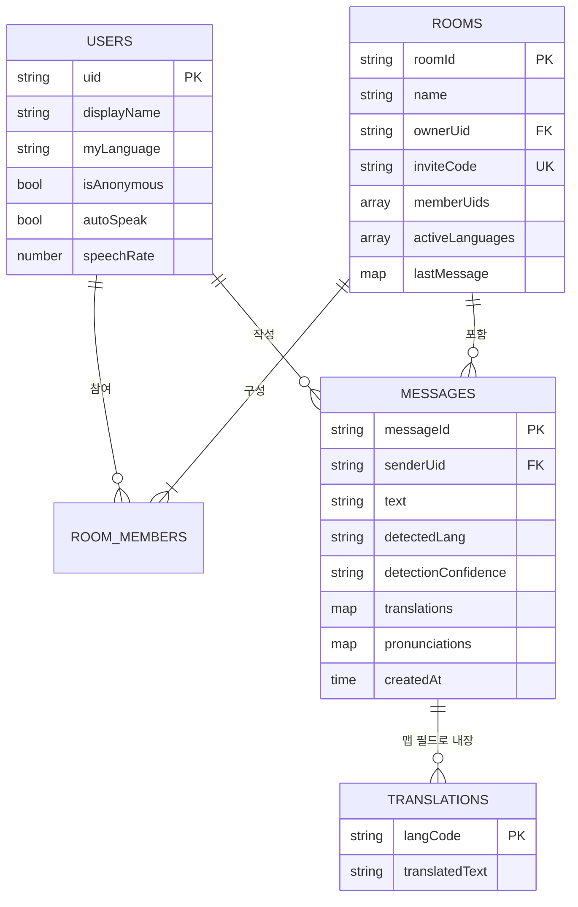

# ERD — 말.통 (MAL.TONG)

**데이터 모델 정의서** · v1.0 · 2026-10-08
대상: Cloud Firestore (NoSQL 문서형)

---

## 1. 전체 구조



**컬렉션 경로**

```
users/{uid}
rooms/{roomId}
rooms/{roomId}/messages/{messageId}
rooms/{roomId}/presence/{uid}        ← 선택 (접속 표시)
```

---

## 2. `users/{uid}`

| 필드 | 타입 | 필수 | 기본값 | 설명 |
|---|---|---|---|---|
| `uid` | string | ✓ | — | Firebase Auth UID (문서 ID와 동일) |
| `displayName` | string | ✓ | — | 표시 이름. 게스트는 입장 시 직접 입력 |
| `email` | string | | null | Google 로그인 시에만 존재 |
| `photoURL` | string | | null | 없으면 이니셜 아바타로 대체 |
| `isAnonymous` | boolean | ✓ | true | 익명 인증 여부 |
| **`myLanguage`** | string | ✓ | `'ko'` | **내가 읽고 들을 언어.** 이 앱의 중심 필드 |
| `autoSpeak` | boolean | ✓ | false | 새 메시지 자동 낭독 |
| `speechRate` | number | ✓ | 1.0 | 0.5 ~ 2.0 |
| `showOriginal` | boolean | ✓ | false | 원문을 항상 펼쳐 둘지 |
| `createdAt` | timestamp | ✓ | serverTimestamp | — |
| `lastSeenAt` | timestamp | | — | — |

```json
{
  "uid": "a1b2c3",
  "displayName": "허우진",
  "email": "herhero78@gmail.com",
  "photoURL": "https://...",
  "isAnonymous": false,
  "myLanguage": "ko",
  "autoSpeak": true,
  "speechRate": 1.0,
  "showOriginal": false,
  "createdAt": "2026-10-08T01:00:00Z",
  "lastSeenAt": "2026-10-08T09:12:00Z"
}
```

> `myLanguage` 는 **UI 번역 언어가 아니다.** 앱 인터페이스의 언어(i18next)와는 별개로,
> "상대 메시지를 어떤 언어로 바꿔 보여줄지"를 정한다. 둘을 같은 필드로 묶으면
> "UI 는 한국어로 두고 메시지는 영어로 보고 싶다" 는 요구를 받을 수 없다.

---

## 3. `rooms/{roomId}`

| 필드 | 타입 | 필수 | 설명 |
|---|---|---|---|
| `name` | string | ✓ | 방 이름 |
| `ownerUid` | string | ✓ | 생성자. 삭제·이름변경·강퇴 권한 |
| **`inviteCode`** | string | ✓ | 8자 대문자+숫자. 초대 링크 `#/join/{code}` |
| `inviteEnabled` | boolean | ✓ | false 면 링크로 더 못 들어옴 |
| `memberUids` | array\<string\> | ✓ | **보안 규칙이 이 배열로 접근을 판정한다** |
| `memberCount` | number | ✓ | `memberUids.length` 비정규화 (목록 표시용) |
| `activeLanguages` | array\<string\> | ✓ | 멤버들의 `myLanguage` 합집합. 중복 제거 |
| `lastMessage` | map | | `{ text, senderName, detectedLang, at }` 방 목록 미리보기 |
| `createdAt` | timestamp | ✓ | — |
| `updatedAt` | timestamp | ✓ | 메시지 전송 때 갱신 → 방 목록 정렬 키 |

```json
{
  "name": "Michael 미팅",
  "ownerUid": "a1b2c3",
  "inviteCode": "K7M2QX9P",
  "inviteEnabled": true,
  "memberUids": ["a1b2c3", "z9y8x7"],
  "memberCount": 2,
  "activeLanguages": ["ko", "en"],
  "lastMessage": {
    "text": "Can we meet at 7pm tomorrow?",
    "senderName": "Michael",
    "detectedLang": "en",
    "at": "2026-10-08T09:12:00Z"
  },
  "createdAt": "2026-10-07T12:00:00Z",
  "updatedAt": "2026-10-08T09:12:00Z"
}
```

### 3.1 `memberUids` 를 배열로 두는 이유

보안 규칙에서 `request.auth.uid in resource.data.memberUids` 한 줄로 판정할 수 있다.
서브컬렉션으로 멤버를 두면 규칙에서 `get()` 을 해야 하고, 이는 **규칙 평가당 추가 읽기**가
과금된다.

**한계**: Firestore `array-contains` 쿼리는 배열 요소 수가 많을수록 느려지고, 문서 1MB
한도에 걸린다. 실측상 멤버 수 **수백 명까지는 문제없다**. 대규모 공개방이 필요해지면
`roomMembers/{roomId}_{uid}` 평면 컬렉션으로 옮긴다.

### 3.2 `inviteCode` 충돌 처리

8자 `A-Z0-9` 조합은 36^8 ≈ 2.8조 가지라 실질 충돌이 없지만, 생성 시
`where('inviteCode','==',code)` 로 한 번 확인하고 중복이면 재생성한다. 최대 5회 시도.

---

## 4. `rooms/{roomId}/messages/{messageId}`

이 앱의 핵심 문서다.

| 필드 | 타입 | 필수 | 설명 |
|---|---|---|---|
| `senderUid` | string | ✓ | 작성자 |
| `senderName` | string | ✓ | 비정규화 (작성 시점 이름 보존) |
| `senderPhotoURL` | string | | — |
| **`senderLang`** | string | ✓ | 작성자의 `myLanguage` **스냅샷**. 감지 실패 시 폴백값 |
| `type` | string | ✓ | `'text'` \| `'image'` \| `'system'` |
| **`text`** | string | ✓ | **원문. 절대 수정하지 않는다** |
| **`detectedLang`** | string | | **실제 감지된 원문 언어.** 첫 번역 시 1회 기록 |
| `detectionConfidence` | string | | `'high'` \| `'low'` — 4자 미만이면 low |
| `detectionSource` | string | | `'auto'` \| `'manual'` — 사용자가 고치면 manual |
| **`translations`** | map\<string,string\> | | `{ "ko": "...", "en": "..." }` 언어코드 → 번역문 |
| `pronunciations` | map\<string,string\> | | 비라틴 번역문의 발음 표기 |
| `imageUrl` | string | | `type === 'image'` 일 때 |
| `createdAt` | timestamp | ✓ | **정렬 키.** `serverTimestamp()` 사용 |
| `deletedAt` | timestamp | | 소프트 삭제. 있으면 "삭제된 메시지" 로 렌더 |

```json
{
  "senderUid": "z9y8x7",
  "senderName": "Michael",
  "senderLang": "en",
  "type": "text",
  "text": "Can we meet at 7pm tomorrow?",
  "detectedLang": "en",
  "detectionConfidence": "high",
  "detectionSource": "auto",
  "translations": {
    "ko": "내일 저녁 7시에 만날 수 있을까요?",
    "zh-CN": "我们明天晚上7点见面好吗？"
  },
  "pronunciations": {
    "zh-CN": "wǒmen míngtiān wǎnshàng 7 diǎn jiànmiàn hǎo ma?"
  },
  "createdAt": "2026-10-08T09:12:00Z"
}
```

### 4.1 `senderLang` 과 `detectedLang` 을 **둘 다** 두는 이유

이것이 기존 챗.첵 버그의 구조적 해법이다.

| 필드 | 출처 | 신뢰도 | 쓰임 |
|---|---|---|---|
| `senderLang` | 작성자의 설정값 | 낮음 | 감지 실패·짧은 문장일 때의 **폴백** |
| `detectedLang` | 문장 실제 감지 | 높음 | **번역 방향 판단의 기준** |

기존 구현은 `senderLang` 하나만 두고 그걸 원문 언어로 썼다. 그래서 한국어로 설정한
사람이 영어를 쓰면 영어 문장에 `ko` 가 붙었다. 두 값을 분리하면 설정과 실제가 달라도
각각 제 역할을 한다.

**읽을 때의 우선순위**

```js
const srcLang = m.detectedLang || m.senderLang || 'ko';
```

### 4.2 `translations` 를 맵 필드로 두는 이유

서브컬렉션(`messages/{id}/translations/{lang}`)으로 두면 메시지 100건을 띄울 때
**추가 읽기가 100회 이상** 발생한다. 맵 필드면 메시지 문서 한 번 읽을 때 같이 온다.

**한계와 대응**

- Firestore 문서 한도는 **1 MiB**.
- 19개 언어 × 평균 200자 ≈ 11 KB → 여유롭다.
- 2,000자짜리 장문 × 19언어 ≈ 114 KB → 여전히 괜찮다.
- **방어선**: `text.length > 2000` 인 메시지는 번역을 Firestore 에 저장하지 않고
  세션 메모리에만 둔다. 캐시 이득을 포기하고 문서 한도를 지킨다.

### 4.3 부분 업데이트 문법

맵 전체를 덮어쓰면 다른 사람이 방금 넣은 번역이 날아간다. **점 표기법**으로 한 키만 쓴다.

```js
// ✅ 맞음 — ko 키만 추가, 나머지 언어는 보존
await updateDoc(ref, { 'translations.ko': '내일 저녁 7시에...' });

// ❌ 틀림 — 다른 언어 번역이 전부 사라진다
await updateDoc(ref, { translations: { ko: '내일 저녁 7시에...' } });
```

---

## 5. 보안 규칙 (`firestore.rules` 전문)

```javascript
rules_version = '2';

service cloud.firestore {
  match /databases/{database}/documents {

    // ---------- 헬퍼 ----------
    function signedIn() {
      return request.auth != null;
    }
    function isMember(roomId) {
      return signedIn()
        && request.auth.uid in get(/databases/$(database)/documents/rooms/$(roomId)).data.memberUids;
    }
    function changedKeys() {
      return request.resource.data.diff(resource.data).affectedKeys();
    }

    // ---------- 사용자 ----------
    match /users/{uid} {
      // 같은 방 멤버의 이름/아바타를 보여줘야 하므로 로그인 사용자에게 읽기 허용
      allow read:   if signedIn();
      allow create: if signedIn() && request.auth.uid == uid;
      allow update: if signedIn() && request.auth.uid == uid;
      allow delete: if false;                         // 계정 삭제는 콘솔/함수로만
    }

    // ---------- 방 ----------
    match /rooms/{roomId} {
      allow read: if signedIn()
        && request.auth.uid in resource.data.memberUids;

      allow create: if signedIn()
        && request.resource.data.ownerUid == request.auth.uid
        && request.auth.uid in request.resource.data.memberUids;

      allow update: if signedIn() && (
        // (a) 방장은 전부 수정 가능
        resource.data.ownerUid == request.auth.uid

        // (b) 멤버는 메시지 전송 시 lastMessage/updatedAt 만 갱신
        || (request.auth.uid in resource.data.memberUids
            && changedKeys().hasOnly(['lastMessage', 'updatedAt', 'activeLanguages']))

        // (c) 초대 링크로 들어오는 사람: 자기 자신만 멤버 배열에 추가
        || (resource.data.inviteEnabled == true
            && changedKeys().hasOnly(['memberUids', 'memberCount', 'activeLanguages'])
            && request.resource.data.memberUids.hasAll(resource.data.memberUids)
            && request.resource.data.memberUids.removeAll(resource.data.memberUids)
                 == [request.auth.uid])
      );

      allow delete: if signedIn() && resource.data.ownerUid == request.auth.uid;

      // ---------- 메시지 ----------
      match /messages/{messageId} {
        allow read: if isMember(roomId);

        allow create: if isMember(roomId)
          && request.resource.data.senderUid == request.auth.uid
          && request.resource.data.text is string
          && request.resource.data.text.size() <= 5000
          && request.resource.data.createdAt == request.time;

        allow update: if isMember(roomId) && (
          // (a) 작성자: 소프트 삭제만
          (resource.data.senderUid == request.auth.uid
           && changedKeys().hasOnly(['deletedAt']))

          // (b) ★ 누구든 번역 캐시는 채울 수 있다 — 이 앱의 핵심 동작
          //     원문(text)·작성자(senderUid)는 건드릴 수 없다
          || changedKeys().hasOnly([
               'translations', 'pronunciations',
               'detectedLang', 'detectionConfidence', 'detectionSource'
             ])
        );

        allow delete: if false;                       // 소프트 삭제만 쓴다
      }

      // ---------- 접속 표시 (선택) ----------
      match /presence/{uid} {
        allow read:  if isMember(roomId);
        allow write: if signedIn() && request.auth.uid == uid;
      }
    }
  }
}
```

### 5.1 규칙에서 가장 중요한 한 줄

```javascript
|| changedKeys().hasOnly(['translations', 'pronunciations', ...])
```

이 앱은 **메시지를 읽는 사람이 그 메시지를 수정한다**(번역을 채워 넣는다).
일반적인 채팅 앱이라면 "작성자만 수정 가능" 이 맞지만, 여기서는 그러면 번역 캐시가
동작하지 않는다. `hasOnly` 로 **번역 관련 키만** 열어 원문 위변조는 막으면서
캐시 쓰기는 허용한다.

> meet4u 에서 이 규칙을 빠뜨려 `permission-denied` 로 번역이 저장되지 않은 적이 있다.
> 증상은 "번역이 매번 다시 요청되고 느리다" 로 나타난다. 콘솔에 에러가 보이므로
> 번역이 안 될 때 가장 먼저 확인할 곳이다.

### 5.2 Storage 규칙

```javascript
rules_version = '2';
service firebase.storage {
  match /b/{bucket}/o {
    match /rooms/{roomId}/{fileName} {
      allow read:  if request.auth != null;
      allow write: if request.auth != null
        && request.resource.size < 5 * 1024 * 1024          // 5MB
        && request.resource.contentType.matches('image/.*');
    }
  }
}
```

---

## 6. 인덱스 (`firestore.indexes.json`)

```json
{
  "indexes": [
    {
      "collectionGroup": "rooms",
      "queryScope": "COLLECTION",
      "fields": [
        { "fieldPath": "memberUids", "arrayConfig": "CONTAINS" },
        { "fieldPath": "updatedAt",  "order": "DESCENDING" }
      ]
    },
    {
      "collectionGroup": "messages",
      "queryScope": "COLLECTION",
      "fields": [
        { "fieldPath": "createdAt", "order": "ASCENDING" }
      ]
    }
  ],
  "fieldOverrides": [
    {
      "collectionGroup": "messages",
      "fieldPath": "translations",
      "indexes": []
    },
    {
      "collectionGroup": "messages",
      "fieldPath": "pronunciations",
      "indexes": []
    }
  ]
}
```

> **`fieldOverrides` 가 중요하다.** `translations` 맵은 언어가 늘어날 때마다 새 키가
> 생기고, Firestore 는 기본적으로 **모든 맵 키에 인덱스를 만든다**. 그대로 두면
> 번역을 저장할 때마다 불필요한 인덱스 쓰기가 발생해 쓰기 비용이 몇 배가 된다.
> 이 필드들은 **쿼리 대상이 아니므로 인덱스를 끈다.**

---

## 7. 주요 쿼리

```js
// 내가 속한 방 목록 (최근 대화순)
query(
  collection(db, 'rooms'),
  where('memberUids', 'array-contains', uid),
  orderBy('updatedAt', 'desc'),
  limit(50)
);

// 방의 최근 메시지 200건 실시간 구독
query(
  collection(db, 'rooms', roomId, 'messages'),
  orderBy('createdAt', 'asc'),
  limitToLast(200)
);

// 초대 코드로 방 찾기 (입장 전이라 멤버가 아님 → 규칙 예외 필요)
query(
  collection(db, 'rooms'),
  where('inviteCode', '==', code),
  where('inviteEnabled', '==', true),
  limit(1)
);
```

> ⚠️ 마지막 쿼리는 **아직 멤버가 아닌 사람**이 실행한다. 위 규칙의
> `allow read: if request.auth.uid in resource.data.memberUids` 에 걸려 실패한다.
> **해결**: 입장 처리를 `joinRoom` Netlify Function(또는 Cloud Function)으로 옮겨
> Admin SDK 로 코드를 조회하고 멤버 배열에 추가한다. 클라이언트에서 초대코드로
> 방 전체를 조회할 수 있게 규칙을 여는 것은 **방 목록 열람 취약점**이 되므로 하지 않는다.

---

## 8. 쓰기 트랜잭션

### 8.1 메시지 전송

```js
const batch = writeBatch(db);
const msgRef = doc(collection(db, 'rooms', roomId, 'messages'));

batch.set(msgRef, {
  senderUid: user.uid,
  senderName: profile.displayName,
  senderPhotoURL: profile.photoURL || null,
  senderLang: profile.myLanguage,          // 폴백용 스냅샷
  type: 'text',
  text: trimmed,
  translations: {},
  pronunciations: {},
  createdAt: serverTimestamp(),
});

batch.update(doc(db, 'rooms', roomId), {
  lastMessage: {
    text: trimmed.slice(0, 100),
    senderName: profile.displayName,
    detectedLang: null,                    // 감지 후 채워짐
    at: serverTimestamp(),
  },
  updatedAt: serverTimestamp(),
});

await batch.commit();
```

> 전송 시점에는 `detectedLang` 을 **비워 둔다.** 보내는 사람의 설정값으로 미리 채우면
> 기존 버그를 그대로 재현하게 된다. 첫 번역이 일어날 때 실제 감지 결과가 기록된다.

### 8.2 방 입장 (멤버 추가 + 언어 집합 갱신)

```js
await runTransaction(db, async (tx) => {
  const ref  = doc(db, 'rooms', roomId);
  const snap = await tx.get(ref);
  if (!snap.exists()) throw new Error('방을 찾을 수 없습니다');

  const d = snap.data();
  if (d.memberUids.includes(uid)) return;            // 이미 멤버
  if (!d.inviteEnabled) throw new Error('초대가 닫혀 있습니다');

  const langs = Array.from(new Set([...(d.activeLanguages || []), myLanguage]));
  tx.update(ref, {
    memberUids: arrayUnion(uid),
    memberCount: d.memberUids.length + 1,
    activeLanguages: langs,
  });
});
```

### 8.3 감지 결과 수동 교정

사용자가 뱃지를 탭해 언어를 바꾸면, **기존 번역을 전부 버리고** 다시 계산한다.
잘못된 원문 언어로 만들어진 번역은 전부 틀렸기 때문이다.

```js
await updateDoc(doc(db, 'rooms', roomId, 'messages', messageId), {
  detectedLang: correctedLang,
  detectionConfidence: 'high',
  detectionSource: 'manual',
  translations: {},                 // ← 전체 초기화. 다음 렌더에서 다시 번역된다
  pronunciations: {},
});
```

---

## 9. 마이그레이션 메모

기존 meet4u 의 `globalChat` 메시지를 가져오려면:

| 기존 필드 | 새 필드 | 변환 |
|---|---|---|
| `senderEmail` | `senderUid` | 이메일 → UID 조회 필요 |
| `sourceLanguage` | **`senderLang`** | ★ `detectedLang` 이 **아니다.** 신뢰할 수 없는 값이므로 폴백 자리로 내린다 |
| `translations` | `translations` | 그대로 |
| `pronunciations` | `pronunciations` | 그대로 |
| `createdAt` | `createdAt` | 그대로 |
| — | `detectedLang` | **비워 둔다.** 처음 조회될 때 실제 감지로 채워진다 |

`sourceLanguage` 를 `detectedLang` 으로 그대로 옮기면 **기존 버그까지 함께 이사한다.**
반드시 `senderLang` 으로 내리고 `detectedLang` 은 비운다.
