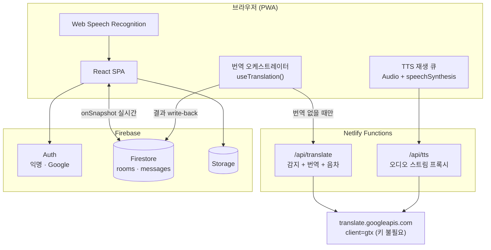

# TRD — 말.통 (MAL.TONG)

**기술 요구사항 정의서** · v1.0 · 2026-10-08

---

## 1. 기술 스택

| 영역 | 선택 | 버전 | 이유 |
|---|---|---|---|
| 프레임워크 | React | 19.x | 기존 자산 재사용 |
| 번들러 | Vite | 7.x | 빠른 HMR, PWA 플러그인 |
| 스타일 | Tailwind CSS | 3.x | 유틸리티 기반, 모바일 반응형 빠름 |
| 라우팅 | react-router-dom (**HashRouter**) | 7.x | 호스팅 rewrite 설정 없이 딥링크 동작 |
| 아이콘 | lucide-react | 최신 | — |
| 인증 | Firebase Auth (**익명 + Google**) | 12.x | 게스트 입장이 핵심 요구사항 |
| DB | Cloud Firestore | 12.x | `onSnapshot` 실시간 구독 |
| 파일 | Firebase Storage | 12.x | 이미지 전송(2차) |
| 서버리스 | Netlify Functions (esbuild, ESM) | — | 번역·TTS 프록시 |
| 호스팅 | Netlify | — | 무료 티어 + Functions 동거 |
| PWA | vite-plugin-pwa | 1.x | 홈 화면 설치 |

> **HashRouter 를 쓰는 이유**: 초대 링크(`/#/join/ABC123`)가 Netlify·Vercel·Firebase
> 어디에 올려도 404 없이 열려야 한다. SEO 가 필요 없는 로그인형 앱이라 해시 URL 의
> 단점이 없다.

---

## 2. 아키텍처



**설계 원칙 세 가지**

1. **서버에 상태를 두지 않는다.** Functions 는 CORS 우회용 순수 프록시다. 재시작해도
   잃을 것이 없다.
2. **번역은 메시지에 눌러 담는다.** 한 번 번역하면 Firestore 메시지 문서에 저장되어
   같은 언어의 다른 사용자는 재사용한다. 번역 호출 수가 사용자 수가 아니라
   **(메시지 수 × 방에서 쓰이는 언어 수)** 로 묶인다.
3. **클라이언트가 DB 를 직접 읽고 쓴다.** 따라서 보안 경계는 애플리케이션 코드가 아니라
   `firestore.rules` 다. UI 로 가리는 것은 보호가 아니다.

---

## 3. 디렉터리 구조

```
src/
├── main.jsx
├── App.jsx                      # HashRouter + 라우트 정의
├── lib/
│   ├── firebase.js              # 앱 초기화, auth/db/storage export
│   ├── languages.js             # ★ 19개 언어 단일 출처
│   ├── detect.js                # 감지 사전 필터 + 신뢰도 판정
│   ├── translate.js             # /api/translate 호출 + 메모리 캐시
│   ├── tts.js                   # 청크 분할 + 재생 큐 + 폴백
│   ├── speech.js                # Web Speech Recognition 래퍼
│   └── rooms.js                 # 방 생성/입장/초대코드 트랜잭션
├── context/
│   ├── AuthContext.jsx          # 익명/구글 인증 + 프로필 onSnapshot
│   └── SettingsContext.jsx      # myLanguage, autoSpeak, speechRate
├── hooks/
│   ├── useMessages.js           # 방 메시지 실시간 구독
│   ├── useAutoTranslate.js      # ★ 번역 오케스트레이션
│   └── useAutoSpeak.js          # 새 메시지 자동 낭독
├── components/
│   ├── room/
│   │   ├── MessageList.jsx
│   │   ├── MessageBubble.jsx    # 번역문 본문 + 원문 접기 + 뱃지
│   │   ├── LangBadge.jsx        # 탭하면 감지 교정
│   │   └── Composer.jsx         # 입력 + 마이크 + 사진
│   ├── LanguageSelect.jsx       # 헤더 셀렉터
│   └── FaceToFace.jsx           # 대면 통역 모드
└── pages/
    ├── Landing.jsx
    ├── Join.jsx
    ├── Room.jsx
    └── Settings.jsx

netlify/functions/
├── translate.js
└── tts.js
```

---

## 4. 핵심 알고리즘

### 4.1 언어 목록 — 단일 출처

언어 목록을 두 군데 이상에 두면 반드시 어긋난다. `src/lib/languages.js` 하나만 둔다.

```js
// src/lib/languages.js
export const LANGUAGES = [
  { code: 'ko',    name: '한국어',           flag: '🇰🇷', speech: 'ko-KR', latin: false },
  { code: 'en',    name: 'English',          flag: '🇺🇸', speech: 'en-US', latin: true  },
  { code: 'zh-CN', name: '中文',             flag: '🇨🇳', speech: 'zh-CN', latin: false },
  { code: 'ja',    name: '日本語',           flag: '🇯🇵', speech: 'ja-JP', latin: false },
  { code: 'ru',    name: 'Русский',          flag: '🇷🇺', speech: 'ru-RU', latin: false },
  { code: 'es',    name: 'Español',          flag: '🇪🇸', speech: 'es-ES', latin: true  },
  { code: 'vi',    name: 'Tiếng Việt',       flag: '🇻🇳', speech: 'vi-VN', latin: true  },
  { code: 'mn',    name: 'Монгол',           flag: '🇲🇳', speech: 'mn-MN', latin: false },
  { code: 'ar',    name: 'العربية',           flag: '🇸🇦', speech: 'ar-SA', latin: false },
  { code: 'fr',    name: 'Français',         flag: '🇫🇷', speech: 'fr-FR', latin: true  },
  { code: 'km',    name: 'ភាសាខ្មែរ',          flag: '🇰🇭', speech: 'km-KH', latin: false },
  { code: 'bn',    name: 'বাংলা',             flag: '🇧🇩', speech: 'bn-BD', latin: false },
  { code: 'uz',    name: 'Oʻzbek',           flag: '🇺🇿', speech: 'uz-UZ', latin: true  },
  { code: 'si',    name: 'සිංහල',            flag: '🇱🇰', speech: 'si-LK', latin: false },
  { code: 'my',    name: 'မြန်မာ',            flag: '🇲🇲', speech: 'my-MM', latin: false },
  { code: 'tl',    name: 'Filipino',         flag: '🇵🇭', speech: 'fil-PH', latin: true },
  { code: 'th',    name: 'ไทย',              flag: '🇹🇭', speech: 'th-TH', latin: false },
  { code: 'id',    name: 'Bahasa Indonesia', flag: '🇮🇩', speech: 'id-ID', latin: true  },
  { code: 'ne',    name: 'नेपाली',            flag: '🇳🇵', speech: 'ne-NP', latin: false },
];

export const LANG_MAP = Object.fromEntries(LANGUAGES.map(l => [l.code, l]));
export const langName = (code) => LANG_MAP[code]?.name || code;
export const langFlag = (code) => LANG_MAP[code]?.flag || '🌐';
export const speechLocale = (code) => LANG_MAP[code]?.speech || 'en-US';

// Google 이 돌려주는 코드를 우리 코드로 정규화한다.
// zh / zh-Hans / zh-cn → zh-CN,  fil → tl,  iw → he 등
const ALIAS = { zh: 'zh-CN', 'zh-hans': 'zh-CN', 'zh-cn': 'zh-CN', 'zh-tw': 'zh-CN', fil: 'tl', in: 'id', iw: 'he' };
export const normalizeLang = (raw) => {
  if (!raw) return null;
  const k = String(raw).toLowerCase();
  const aliased = ALIAS[k] || k;
  const hit = LANGUAGES.find(l => l.code.toLowerCase() === aliased);
  if (hit) return hit.code;
  const base = aliased.split('-')[0];
  return LANGUAGES.find(l => l.code.toLowerCase().split('-')[0] === base)?.code || null;
};
```

### 4.2 감지 + 번역을 한 번에 — 이 앱의 심장

Google Translate `gtx` 엔드포인트는 `sl=auto` 로 호출하면 **번역 결과와 감지된 원문
언어를 같은 응답에 담아** 돌려준다. 감지를 위해 따로 호출할 필요가 없다.

**요청**

```
GET https://translate.googleapis.com/translate_a/single
      ?client=gtx
      &sl=auto          ← 자동 감지
      &tl=ko            ← 받는 사람의 언어
      &dt=t             ← 번역문
      &q=Can%20we%20meet%20at%207pm
```

**응답 (배열 중첩)**

```json
[
  [ ["내일 저녁 7시에 만날 수 있을까요?", "Can we meet at 7pm tomorrow?", null, null, 10] ],
  null,
  "en",            ← ★ 감지된 원문 언어. 인덱스 [2]
  null, null, null, null, []
]
```

**파싱 규칙**

| 위치 | 의미 |
|---|---|
| `data[0]` | 번역 청크 배열. 긴 글은 여러 조각으로 쪼개져 온다 |
| `data[0][i][0]` | i번째 조각의 번역문 → **전부 이어 붙여야 한다** |
| `data[0][i][1]` | i번째 조각의 원문 |
| `data[2]` | **감지된 원문 언어 코드** |

> ⚠️ `data[0][0][0]` 만 읽으면 긴 문장이 잘린다. 반드시 `map(c => c[0]).join('')` 한다.
> 기존 meet4u 에서 TTS 가 중간에 끊겼던 것과 같은 계열의 실수다.

### 4.3 번역 전 사전 필터

호출 전에 걸러낸다. 비용과 오역을 동시에 줄인다.

```js
// src/lib/detect.js
const URL_ONLY   = /^\s*https?:\/\/\S+\s*$/i;
const NO_LETTERS = /^[\s\d\p{P}\p{S}\p{Emoji}]*$/u;   // 숫자·기호·이모지만

/**
 * @returns {{ skip: boolean, reason?: string, confidence: 'high'|'low' }}
 */
export const preCheck = (text) => {
  const t = String(text || '').trim();
  if (!t)                return { skip: true, reason: 'empty',    confidence: 'low' };
  if (URL_ONLY.test(t))  return { skip: true, reason: 'url',      confidence: 'low' };
  if (NO_LETTERS.test(t))return { skip: true, reason: 'symbols',  confidence: 'low' };

  // 4자 미만은 어떤 감지기도 못 맞힌다. 감지는 하되 믿지 않는다.
  const letters = t.replace(/\s/g, '').length;
  return { skip: false, confidence: letters < 4 ? 'low' : 'high' };
};
```

### 4.4 번역 오케스트레이션

메시지가 화면에 보일 때, 내 언어 번역이 없으면 가져와서 **Firestore 에 돌려쓴다.**
다음 사람은 공짜로 읽는다.

```js
// src/hooks/useAutoTranslate.js
import { useEffect, useRef } from 'react';
import { doc, updateDoc } from 'firebase/firestore';
import { db } from '../lib/firebase';
import { preCheck } from '../lib/detect';
import { requestTranslate } from '../lib/translate';

export const useAutoTranslate = (roomId, messages, myLang, myUid) => {
  // 같은 탭에서 같은 메시지를 중복 요청하지 않기 위한 in-flight 집합
  const inFlight = useRef(new Set());

  useEffect(() => {
    if (!roomId || !myLang) return;

    messages.forEach(async (m) => {
      if (m.senderUid === myUid) return;              // 내 글은 번역 안 함
      if (!m.text) return;
      if (m.translations?.[myLang]) return;           // 이미 있음 (캐시 적중)

      const key = `${m.id}:${myLang}`;
      if (inFlight.current.has(key)) return;

      const pre = preCheck(m.text);
      if (pre.skip) return;

      // 감지가 이미 끝났고 그게 내 언어면 번역 불필요
      if (m.detectedLang && m.detectedLang === myLang) return;

      inFlight.current.add(key);
      try {
        const r = await requestTranslate({
          text: m.text,
          targetLang: myLang,
          sourceLang: 'auto',
        });

        const patch = { [`translations.${myLang}`]: r.translatedText };

        // 감지 결과는 처음 번역한 사람이 한 번만 기록한다.
        if (!m.detectedLang && r.detectedLang) {
          // 짧은 문장이면 보낸 사람의 설정 언어를 우선한다 (PRD 7.2)
          patch.detectedLang = pre.confidence === 'low'
            ? (m.senderLang || r.detectedLang)
            : r.detectedLang;
          patch.detectionConfidence = pre.confidence;
          patch.detectionSource = 'auto';
        }
        if (r.romanization) patch[`pronunciations.${myLang}`] = r.romanization;

        await updateDoc(doc(db, 'rooms', roomId, 'messages', m.id), patch);
      } catch (e) {
        console.error('[translate]', m.id, e);
      } finally {
        inFlight.current.delete(key);
      }
    });
  }, [roomId, messages, myLang, myUid]);
};
```

**경합 상황**: 세 사람이 동시에 같은 메시지를 열면 같은 번역이 세 번 요청될 수 있다.
결과가 같으므로 `updateDoc` 이 덮어써도 문제없다. 쓰기 3회를 아끼려 잠금을 걸면
복잡도가 이득보다 크다. **의도적으로 허용한다.**

### 4.5 렌더링 결정

```js
// MessageBubble 안
const isMine   = m.senderUid === myUid;
const srcLang  = m.detectedLang || m.senderLang || 'ko';
const needsTr  = !isMine && srcLang !== myLang && !preCheck(m.text).skip;
const translated = m.translations?.[myLang];

const bodyText  = isMine ? m.text : (translated || m.text);
const showOrig  = !isMine && translated && translated !== m.text;
const isPending = needsTr && !translated;   // 번역 대기 → 원문 흐리게 + 스피너
const ttsLang   = isMine ? srcLang : myLang;
const ttsText   = bodyText;
```

### 4.6 TTS — 끝까지 읽기

Google TTS 는 **요청당 약 200자** 제한이 있다. 넘기면 잘린다.
문장 → 쉼표 → 공백 → 강제 순으로 쪼개고, 순서대로 이어 재생한다.

```js
// src/lib/tts.js
const MAX = 180;   // 200 에 여유를 둔다

export const chunkText = (text) => {
  const out = [];
  let rest = String(text || '').trim();
  while (rest.length > MAX) {
    let cut = -1;
    // 1순위: 문장 끝
    for (const re of [/[.!?。！？]\s/g, /[,，、;]\s/g, /\s/g]) {
      let m, last = -1;
      re.lastIndex = 0;
      while ((m = re.exec(rest)) && m.index < MAX) last = m.index + m[0].length;
      if (last > 0) { cut = last; break; }
    }
    if (cut <= 0) cut = MAX;           // 2순위: 강제 절단
    out.push(rest.slice(0, cut).trim());
    rest = rest.slice(cut).trim();
  }
  if (rest) out.push(rest);
  return out;
};

/** 청크를 순서대로 재생하는 컨트롤러. stop() 으로 중간에 끊을 수 있다. */
export const speak = (text, lang, { rate = 1 } = {}) => {
  const chunks = chunkText(text);
  let i = 0, audio = null, stopped = false;

  const playNext = () => {
    if (stopped || i >= chunks.length) { onDone?.(); return; }
    const q = encodeURIComponent(chunks[i++]);
    audio = new Audio(`/api/tts?lang=${encodeURIComponent(lang)}&text=${q}`);
    audio.playbackRate = rate;
    audio.onended = playNext;
    audio.onerror = () => fallbackNative(chunks.slice(i - 1).join(' '), lang, rate);
    audio.play().catch(() => fallbackNative(chunks.slice(i - 1).join(' '), lang, rate));
  };

  let onDone = null;
  playNext();
  return {
    stop() { stopped = true; audio?.pause(); window.speechSynthesis?.cancel(); },
    set onended(fn) { onDone = fn; },
  };
};

/** Google TTS 가 막히면 브라우저 내장 음성으로 떨어진다. */
const fallbackNative = (text, lang, rate) => {
  if (!window.speechSynthesis) return;
  const u = new SpeechSynthesisUtterance(text);
  u.lang = speechLocale(lang);
  u.rate = rate;
  window.speechSynthesis.speak(u);
};
```

> **iOS Safari 주의**: 사용자의 탭(클릭) 없이 `audio.play()` 를 처음 호출하면 차단된다.
> 자동 음성을 켜는 토글 버튼을 누르는 순간 무음 오디오를 한 번 재생해 **오디오 컨텍스트를
> 해제**해 두어야 이후 자동 재생이 동작한다.

### 4.7 자동 낭독

```js
// src/hooks/useAutoSpeak.js
export const useAutoSpeak = (messages, myLang, myUid, enabled) => {
  const spoken = useRef(new Set());
  const ready  = useRef(false);     // 첫 로드분은 읽지 않기 위한 플래그

  useEffect(() => {
    if (!enabled) { ready.current = false; return; }
    if (!ready.current) {
      // 구독 시작 시점에 이미 있던 메시지는 "읽은 것"으로 표시만 하고 넘어간다
      messages.forEach(m => spoken.current.add(m.id));
      ready.current = true;
      return;
    }
    if (document.hidden) return;

    messages.forEach(m => {
      if (spoken.current.has(m.id)) return;
      spoken.current.add(m.id);
      if (m.senderUid === myUid) return;
      const text = m.translations?.[myLang] || m.text;
      if (text) speak(text, myLang);
    });
  }, [messages, myLang, myUid, enabled]);
};
```

---

## 5. Netlify Functions

### 5.1 `/api/translate`

**계약**

```
POST /api/translate
Content-Type: application/json

{ "text": "Can we meet at 7pm?", "targetLang": "ko", "sourceLang": "auto", "withRomanization": false }
```

```json
200 OK
{
  "translatedText": "7시에 만날 수 있을까요?",
  "detectedLang": "en",
  "romanization": null
}
```

| 상태 | 의미 | 클라이언트 동작 |
|---|---|---|
| 200 | 성공 | 저장 |
| 400 | text 없음 / targetLang 미지원 | 조용히 포기 |
| 429 | 구글 레이트 리밋 | 지수 백오프 후 1회 재시도, 실패 시 원문 표시 |
| 502 | 상류 응답 파싱 실패 | 원문 표시 |

**구현**

```js
// netlify/functions/translate.js
const GTX = 'https://translate.googleapis.com/translate_a/single';

export const handler = async (event) => {
  if (event.httpMethod !== 'POST') return { statusCode: 405, body: 'Method Not Allowed' };

  let body;
  try { body = JSON.parse(event.body || '{}'); }
  catch { return json(400, { error: 'bad json' }); }

  const text = String(body.text || '').slice(0, 5000);   // 상류 보호
  const tl   = String(body.targetLang || '');
  const sl   = String(body.sourceLang || 'auto');
  if (!text.trim() || !tl) return json(400, { error: 'text and targetLang required' });

  const dt = body.withRomanization ? 'dt=t&dt=rm' : 'dt=t';
  const url = `${GTX}?client=gtx&sl=${encodeURIComponent(sl)}&tl=${encodeURIComponent(tl)}&${dt}&q=${encodeURIComponent(text)}`;

  try {
    const res = await fetch(url, { headers: { 'User-Agent': 'Mozilla/5.0' } });
    if (res.status === 429) return json(429, { error: 'rate limited' });
    if (!res.ok)            return json(502, { error: `upstream ${res.status}` });

    const data = await res.json();
    const chunks = Array.isArray(data?.[0]) ? data[0] : [];

    // ★ 모든 청크를 이어 붙인다. 첫 조각만 쓰면 긴 글이 잘린다.
    const translatedText = chunks.map(c => c?.[0] || '').join('');
    const romanization   = body.withRomanization
      ? chunks.map(c => c?.[3] || '').join(' ').trim() || null
      : null;

    return json(200, {
      translatedText,
      detectedLang: data?.[2] || null,     // ★ 감지 결과
      romanization,
    });
  } catch (e) {
    return json(502, { error: String(e?.message || e) });
  }
};

const json = (statusCode, obj) => ({
  statusCode,
  headers: { 'Content-Type': 'application/json', 'Cache-Control': 'no-store' },
  body: JSON.stringify(obj),
});
```

### 5.2 `/api/tts`

브라우저에서 `translate_tts` 를 직접 부르면 CORS 로 막힌다. 프록시가 필요하다.

```js
// netlify/functions/tts.js
export const handler = async (event) => {
  const { text = '', lang = 'ko' } = event.queryStringParameters || {};
  const q = String(text).slice(0, 200);           // 상류 한도
  if (!q.trim()) return { statusCode: 400, body: 'text required' };

  const url = 'https://translate.googleapis.com/translate_tts'
    + `?ie=UTF-8&client=gtx&tl=${encodeURIComponent(lang)}`
    + `&q=${encodeURIComponent(q)}&textlen=${q.length}`;

  const res = await fetch(url, { headers: { 'User-Agent': 'Mozilla/5.0', Referer: 'https://translate.google.com/' } });
  if (!res.ok) return { statusCode: 502, body: `upstream ${res.status}` };

  const buf = Buffer.from(await res.arrayBuffer());
  return {
    statusCode: 200,
    headers: {
      'Content-Type': 'audio/mpeg',
      'Cache-Control': 'public, max-age=86400',   // 같은 문장 재생 시 재요청 안 함
    },
    body: buf.toString('base64'),
    isBase64Encoded: true,
  };
};
```

### 5.3 `netlify.toml`

```toml
[build]
  command  = "npm run build"
  publish  = "dist"
  functions = "netlify/functions"

[functions]
  node_bundler = "esbuild"

[[redirects]]
  from = "/api/*"
  to   = "/.netlify/functions/:splat"
  status = 200

[[redirects]]
  from = "/*"
  to   = "/index.html"
  status = 200
```

---

## 6. 음성 입력 (STT)

```js
// src/lib/speech.js
export const createRecognizer = (langCode, { onResult, onEnd, onError }) => {
  const SR = window.SpeechRecognition || window.webkitSpeechRecognition;
  if (!SR) return null;                       // 미지원 → 마이크 버튼 숨김

  const r = new SR();
  r.lang = speechLocale(langCode);            // 'ko-KR', 'en-US' …
  r.continuous = true;
  r.interimResults = true;

  r.onresult = (e) => {
    let final = '', interim = '';
    for (let i = e.resultIndex; i < e.results.length; i++) {
      const t = e.results[i][0].transcript;
      if (e.results[i].isFinal) final += t; else interim += t;
    }
    onResult?.({ final, interim });
  };
  r.onend   = () => onEnd?.();
  r.onerror = (e) => onError?.(e.error);
  return r;
};
```

> **지원 현실**: Chrome·Edge·Samsung Internet 은 잘 된다. **Firefox 는 미지원**,
> iOS Safari 는 16.4+ 에서 부분 지원이며 `continuous` 가 불안정하다.
> 미지원 브라우저에서는 마이크 버튼을 **숨긴다**. 눌리지 않는 버튼을 두지 않는다.

---

## 7. 대면 통역 모드 (F14)

한 기기를 마주 놓고 쓰는 모드. 기록을 남기지 않는 휘발성 화면이다.

```
┌─────────────────────┐
│   English (상대)     │  ← 180° 회전 (CSS transform: rotate(180deg))
│  "Nice to meet you" │
│        🔊           │
├─────────────────────┤
│  [🎤 눌러서 말하기]   │  ← 공용 버튼
├─────────────────────┤
│   한국어 (나)        │
│  "만나서 반갑습니다"  │
│        🔊           │
└─────────────────────┘
```

**동작**

1. 마이크 버튼을 누르면 `continuous` 인식을 시작한다. 인식 로케일은 **마지막에 말한
   사람의 반대편 언어**를 기본값으로 하되, 결과 텍스트를 다시 `sl=auto` 로 번역하므로
   로케일이 틀려도 복구된다.
2. 최종 결과가 나오면 `/api/translate` 에 `sl=auto`, `tl=반대편 언어` 로 보낸다.
3. 응답의 `detectedLang` 으로 **어느 쪽이 말했는지** 판정해서, 번역문을 반대편 영역에
   큰 글씨로 띄우고 바로 읽어준다.
4. Firestore 에 저장하지 않는다. 화면 상태(useState)로만 둔다.

---

## 8. 성능

| 항목 | 방법 |
|---|---|
| 메시지 목록 | 최근 200건만 구독(`limit(200)`), 위로 스크롤 시 추가 로드 |
| 번역 호출 | 화면에 보이는 메시지만 — `IntersectionObserver` 로 가시성 판정 |
| TTS 오디오 | Functions 응답에 `max-age=86400` → 같은 문장 재생 시 CDN 히트 |
| 번들 | 대면 통역 모드와 설정 화면은 `React.lazy` 로 분리 |
| 리렌더 | `MessageBubble` 을 `React.memo` 로 감싸고 `translations[myLang]` 만 의존 |

---

## 9. 함정 모음 — 구현 전에 반드시 읽을 것

| # | 증상 | 원인 | 대응 |
|---|---|---|---|
| 1 | 영어로 쓴 글에 🇰🇷 뱃지 | **보낸 사람 설정을 원문 언어로 씀** | 메시지마다 `sl=auto` 로 실제 감지 (4.2) |
| 2 | 긴 문장이 중간에 잘림 | `data[0][0][0]` 만 읽음 | 모든 청크 `join('')` (4.2) |
| 3 | TTS 가 200자에서 멈춤 | 상류 요청당 한도 | 청크 분할 + 순차 재생 (4.6) |
| 4 | iOS 에서 자동 음성 무음 | 사용자 제스처 없는 `play()` 차단 | 토글 켤 때 무음 1회 재생해 해제 (4.6) |
| 5 | 언어 바꿔도 화면이 그대로 | `myLang` 이 의존성 배열에 없음 | `useEffect` 의존성에 `myLang` 포함 |
| 6 | 같은 번역이 수십 번 요청됨 | in-flight 가드 없음 | `useRef(new Set())` 로 중복 차단 (4.4) |
| 7 | 번역이 저장되지 않음 (권한 거부) | 규칙이 작성자만 수정 허용 | `translations`/`pronunciations` 키만 멤버에게 허용 (ERD 5장) |
| 8 | 들어오자마자 과거 메시지를 몰아 읽음 | 첫 스냅샷도 "새 메시지"로 봄 | `ready` 플래그로 초기 분을 건너뜀 (4.7) |
| 9 | `zh` 와 `zh-CN` 이 다른 언어로 취급됨 | 코드 정규화 없음 | `normalizeLang()` 통과 (4.1) |
| 10 | 초대 링크가 404 | BrowserRouter + rewrite 미설정 | **HashRouter** 사용 (1장) |
| 11 | 익명 사용자가 새로고침하면 남이 됨 | 익명 세션 persistence 미설정 | `browserLocalPersistence` 명시 설정 |
| 12 | Firestore 문서 1MB 초과 | 긴 글 × 19개 언어 번역 누적 | 2000자 초과 메시지는 번역을 저장하지 않고 세션 메모리에만 둠 |
| 13 | 번역 요청이 CORS 로 막힘 | 브라우저에서 gtx 직접 호출 | 반드시 Functions 프록시 경유 |
| 14 | 이모지만 보냈는데 "번역 중" 이 안 끝남 | 사전 필터 없음 | `preCheck()` 로 스킵 (4.3) |

---

## 10. 외부 의존성과 비용

| 서비스 | 무료 한도 | 초과 시 증상 | 대안 |
|---|---|---|---|
| Google Translate `gtx` | 공식 한도 없음(**비공식 엔드포인트**) | 429 또는 차단 → 번역 실패, 원문 표시 | Cloud Translation API (유료, 월 50만자 무료) |
| Google Translate TTS | 동일 | 오디오 502 → Web Speech 폴백 | Cloud TTS (유료) |
| Web Speech API | 무제한 | — | — |
| Firestore 읽기 | 50,000/일 | 메시지가 안 보임 | Blaze 플랜 |
| Firestore 쓰기 | 20,000/일 | 전송·번역 저장 실패 | Blaze 플랜 |
| Netlify Functions | 125,000회/월 | 번역·TTS 정지 | 유료 플랜 |
| Netlify 대역폭 | 100 GB/월 | 사이트 정지 | 유료 플랜 |

> **`client=gtx` 는 구글이 공식 지원하는 엔드포인트가 아니다.** 언제든 막힐 수 있고,
> 그때 번역은 조용히 실패한다. 교체 지점을 `netlify/functions/translate.js`
> **한 파일로 격리**해 둔 이유가 이것이다. 공식 API 로 갈아탈 때 클라이언트는 손대지
> 않는다.

### 사용량 신호등

우측 하단에 배터리 모양 인디케이터를 둔다. 서버리스라 서버 헬스 엔드포인트가 없으므로
`localStorage` 에 일/월 카운터를 두고 추정한다.

- 집계 대상: Firestore 읽기/쓰기(일), Functions 호출(월)
- `window.fetch` 를 **한 번만** 감싸 `/api/` 호출을 자동 집계 (이중 패치 가드 필수)
- 임계: 모든 메트릭 사용률 중 worst 기준 40% / 70% / 90%
- 색: `ok #43a047` · `warn #fbc02d` · `danger #f57c00` · `critical #e53935`
- 모션: critical 0.6s 점멸 / danger 1.2s / warn 느린 호흡 / ok 정적

---

## 11. 환경 변수

```bash
# .env  (gitignore 필수)
VITE_FIREBASE_API_KEY=
VITE_FIREBASE_AUTH_DOMAIN=
VITE_FIREBASE_PROJECT_ID=
VITE_FIREBASE_STORAGE_BUCKET=
VITE_FIREBASE_MESSAGING_SENDER_ID=
VITE_FIREBASE_APP_ID=
```

Functions 쪽은 키가 필요 없다. `gtx` 는 인증하지 않는다.
공식 API 로 전환할 때만 `GOOGLE_TRANSLATE_API_KEY` 가 추가된다.

---

## 12. 배포

```bash
npm install
npm run dev                  # http://localhost:5173
netlify dev                  # Functions 포함 로컬 구동 (번역 테스트는 이쪽)

npm run build
netlify deploy --prod

firebase deploy --only firestore:rules,firestore:indexes,storage:rules
```

> 로컬에서 `npm run dev` 만 띄우면 `/api/translate` 가 404 다. 번역을 테스트하려면
> 반드시 `netlify dev` 를 쓴다.
